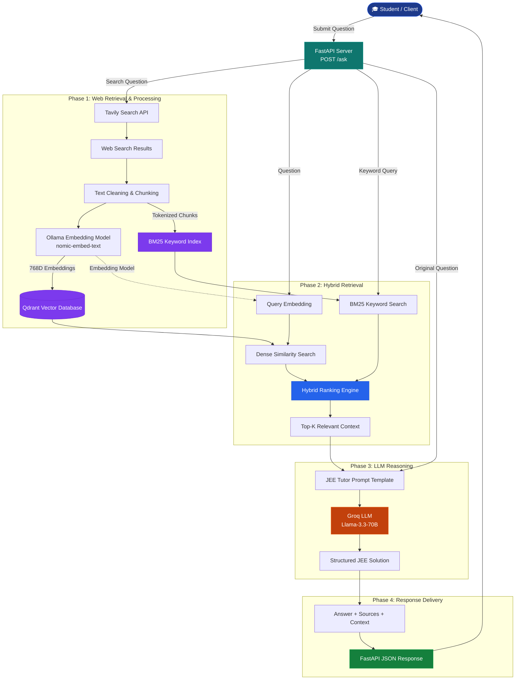

# 🎓 JEE-RAG — Advanced IIT-JEE Question Answering System

**An AI-powered Retrieval-Augmented Generation (RAG) system for solving IIT-JEE Main and Advanced questions using hybrid retrieval, vector search, and structured LLM reasoning.**

JEE-RAG combines real-time web search, local embeddings, dense and sparse retrieval, and large language models to generate context-aware, step-by-step solutions for **Physics, Chemistry, and Mathematics**.

Built with **FastAPI, Tavily, Ollama, Qdrant, BM25, and Groq**, the system retrieves relevant educational content and uses it to produce structured explanations tailored to competitive examination preparation.

---

## ✨ Key Features

- **Real-Time Web Retrieval:** Integrates Tavily Search API to retrieve relevant educational resources and supporting information.
- **Hybrid Search Architecture:** Combines Qdrant dense vector similarity search with BM25 keyword-based retrieval.
- **Local Vector Embeddings:** Uses Ollama's `nomic-embed-text` model to generate 768-dimensional semantic embeddings.
- **Vector Database Integration:** Stores and retrieves document embeddings through Qdrant Cloud or a local Qdrant instance.
- **Intelligent Document Processing:** Cleans, chunks, and processes retrieved web content before indexing.
- **LLM-Powered Reasoning:** Uses Groq-hosted `llama-3.3-70b-versatile` to generate structured solutions.
- **JEE-Specific Prompt Engineering:** Applies a specialized tutor prompt to guide concept identification, mathematical reasoning, and step-by-step explanations.
- **Source-Aware Responses:** Returns supporting web sources and retrieved context chunks alongside generated answers.
- **RESTful API:** Provides FastAPI endpoints for question answering and service health monitoring.
- **Automated Setup Verification:** Includes a diagnostic script to validate credentials, dependencies, and external service connectivity.

---

## 🛠️ Tech Stack

| Category | Technology |
|---|---|
| Programming Language | Python |
| Backend Framework | FastAPI, Uvicorn |
| Web Retrieval | Tavily Search API |
| Embedding Model | Ollama — `nomic-embed-text` |
| Vector Database | Qdrant |
| Dense Retrieval | Cosine Similarity Search |
| Sparse Retrieval | BM25 |
| Hybrid Ranking | Dense + BM25 Score Fusion |
| LLM Inference | Groq API |
| Language Model | `llama-3.3-70b-versatile` |
| Data Validation | Pydantic |
| API Documentation | Swagger UI / OpenAPI |

---

## 🏗️ System Architecture

JEE-RAG follows a modular retrieval-augmented generation architecture consisting of four primary stages:

1. Web Search and Document Processing
2. Embedding and Hybrid Retrieval
3. Context-Aware Answer Generation
4. API Response Delivery

### Complete Architecture Flowchart



---

## 🔄 Architecture & Workflow Explained

### Phase 1: Web Retrieval and Document Processing

The pipeline begins when a student submits an IIT-JEE question through the FastAPI endpoint.

**Step 1 — Question Submission**

The user sends a question to:

`POST /ask`

**Step 2 — Real-Time Web Search**

The application sends the question to the Tavily Search API, which retrieves relevant educational content.

**Step 3 — Text Processing**

The retrieved content undergoes cleaning and chunking to prepare it for efficient retrieval.

**Step 4 — Embedding Generation**

Ollama's `nomic-embed-text` model converts text chunks into 768-dimensional dense vectors.

**Step 5 — Indexing**

The processed information is made available through two retrieval mechanisms:

- **Qdrant:** Stores semantic vector embeddings for dense similarity search.
- **BM25:** Provides lexical matching based on keywords and term relevance.

### Phase 2: Hybrid Retrieval

JEE-RAG uses a hybrid retrieval strategy to combine semantic understanding with exact keyword matching.

**Dense Retrieval**

The user's question is embedded using Ollama and compared against stored vectors in Qdrant using cosine similarity.

This helps identify conceptually relevant information even when the wording differs.

**Sparse Retrieval**

BM25 ranks text chunks using keyword frequency and document relevance.

This is particularly useful for mathematical terminology, named concepts, formulas, and exact technical expressions.

**Hybrid Ranking**

The ranking engine combines dense similarity and BM25 relevance scores to identify the most useful context.

The highest-ranked chunks are selected as the Top-K retrieval results.

### Phase 3: Context-Aware Answer Generation

The retrieved context is passed to the Groq-hosted language model.

**LLM:** `llama-3.3-70b-versatile`

A specialized IIT-JEE tutor prompt guides the model to generate structured educational explanations.

The intended answer format includes:

1. **Concept Identification:** Identify the relevant topic and principles.
2. **Key Formulas:** Explain applicable equations and relationships.
3. **Step-by-Step Solution:** Show the reasoning and mathematical derivation.
4. **Final Answer:** Present the result clearly.
5. **Supporting Sources:** Return the references used during retrieval.

### Phase 4: API Response Delivery

The generated solution is returned through FastAPI as a structured JSON response containing the original question, generated answer, supporting web sources, and retrieved context chunks with relevance scores.

---

## 📂 Project Structure

```text
JEE-RAG/
│
├── main.py                 # FastAPI application and endpoints
├── config.py               # Environment configuration
├── models.py               # Pydantic request/response schemas
│
├── search.py               # Tavily web retrieval
├── retriever.py            # Chunking, Qdrant, and BM25 retrieval
├── embedder.py             # Ollama embedding client
├── generator.py            # Groq LLM and JEE tutor prompt
│
├── verify_setup.py         # Dependency and API diagnostics
├── requirements.txt        # Python dependencies
├── .env.example            # Environment variable template
├── .gitignore              # Git exclusions
│
├── run.ps1                 # PowerShell startup script
└── run.bat                 # Windows batch startup script
```

---

## 🚀 Getting Started

### Prerequisites

Before running the project, ensure that the following are available:

- Python 3.10–3.13
- Ollama installed locally
- Groq API key
- Tavily API key
- Qdrant Cloud cluster or local Qdrant instance

### Step 1: Clone the Repository

```bash
git clone https://github.com/YOUR_USERNAME/JEE-RAG.git
cd JEE-RAG
```

Replace `YOUR_USERNAME` with your GitHub username.

### Step 2: Create a Virtual Environment

```bash
python -m venv .venv
```

Activate the environment.

**Windows PowerShell**

```powershell
.\.venv\Scripts\Activate.ps1
```

**Windows CMD**

```cmd
.venv\Scripts\activate.bat
```

**Linux / macOS**

```bash
source .venv/bin/activate
```

### Step 3: Install Dependencies

```bash
pip install -r requirements.txt
```

### Step 4: Set Up Ollama

Download and install Ollama from:

https://ollama.com

Pull the embedding model:

```bash
ollama pull nomic-embed-text
```

Ensure the Ollama service is running.

If necessary, start it with:

```bash
ollama serve
```

### Step 5: Configure Environment Variables

Create a `.env` file in the root directory.

**Windows**

```cmd
copy .env.example .env
```

**Linux / macOS**

```bash
cp .env.example .env
```

Configure the environment:

```dotenv
# Groq Configuration
GROQ_API_KEY=your_groq_api_key
GROQ_MODEL=llama-3.3-70b-versatile

# Tavily Configuration
TAVILY_API_KEY=your_tavily_api_key

# Qdrant Configuration
QDRANT_URL=https://your-qdrant-cluster-url
QDRANT_API_KEY=your_qdrant_api_key
QDRANT_COLLECTION=jee-rag

# Ollama Configuration
OLLAMA_BASE_URL=http://localhost:11434
OLLAMA_EMBED_MODEL=nomic-embed-text

# Server Configuration
HOST=0.0.0.0
PORT=8000
```

**Important:** Never commit your `.env` file or actual API credentials to GitHub.

### Step 6: Verify Setup

Run the diagnostic script:

```bash
python verify_setup.py
```

This checks the configured dependencies, credentials, and service connectivity.

### Step 7: Start the Application

**Option A — Python**

```bash
python main.py
```

**Option B — Uvicorn**

```bash
uvicorn main:app --host 0.0.0.0 --port 8000 --reload
```

**Option C — Windows Startup Scripts**

```powershell
.\run.ps1
```

Or:

```cmd
run.bat
```

The application will be available at:

http://localhost:8000

**Interactive API Documentation:**

http://localhost:8000/docs

---

## 📡 API Reference

### 1. Health Check

**Endpoint**

```http
GET /health
```

**Example Response**

```json
{
  "status": "ok"
}
```

### 2. Ask a JEE Question

**Endpoint**

```http
POST /ask
```

**Request Body**

```json
{
  "question": "A particle moves in a circle of radius R. What is the centripetal acceleration if its speed is v?"
}
```

**Example Response**

```json
{
  "question": "A particle moves in a circle of radius R. What is the centripetal acceleration if its speed is v?",
  "answer": "CONCEPT: Uniform Circular Motion\n\nKEY PRINCIPLES:\nCentripetal acceleration acts toward the center of the circular path.\n\nFORMULA:\na = v²/R\n\nSOLUTION:\n1. The particle moves along a circular path of radius R.\n2. Its velocity changes direction continuously.\n3. The resulting centripetal acceleration has magnitude v²/R.\n\nFINAL ANSWER:\na = v²/R",
  "sources": [
    {
      "url": "https://example.com/circular-motion",
      "title": "Circular Motion Fundamentals",
      "snippet": "Centripetal acceleration is given by v²/R."
    }
  ],
  "context_chunks": [
    {
      "url": "https://example.com/circular-motion",
      "title": "Circular Motion Fundamentals",
      "chunk_text": "For a particle moving at speed v along a circle of radius R, centripetal acceleration is v²/R.",
      "score": 0.88
    }
  ]
}
```

*Note: This is an illustrative response. The source URL, relevance score, and generated wording are examples rather than results from a live API request.*

### 3. Test Using cURL

```bash
curl -X POST "http://localhost:8000/ask" \
  -H "Content-Type: application/json" \
  -d '{
    "question": "Explain the work-energy theorem with an example."
  }'
```

---

## 🧠 Core Technical Concepts

### Retrieval-Augmented Generation (RAG)

RAG improves language-model responses by retrieving relevant external information before generating an answer.

Rather than relying exclusively on the model's pretrained knowledge, JEE-RAG supplies additional context from retrieved educational resources.

### Dense Vector Search

Dense retrieval represents questions and documents as numerical embeddings.

Using Ollama's `nomic-embed-text` model, JEE-RAG generates semantic vectors that can be compared through Qdrant.

This enables concept-based retrieval.

### BM25 Keyword Retrieval

BM25 is a probabilistic ranking algorithm used to measure the relevance of text documents to a search query.

It is particularly effective for identifying exact terms, formulas, and domain-specific vocabulary.

### Hybrid Search

JEE-RAG combines two complementary retrieval methods:

| Dense Retrieval | BM25 Retrieval |
|---|---|
| Semantic similarity | Keyword relevance |
| Understands related concepts | Matches exact terminology |
| Uses vector embeddings | Uses lexical scoring |
| Powered by Qdrant | Powered by custom BM25 |

The hybrid ranker combines their relevance signals to select the most appropriate context.

### Prompt-Engineered Reasoning

The Groq-hosted LLM receives a specialized tutor prompt designed to encourage systematic problem solving.

The prompt emphasizes concept identification, correct formula selection, detailed mathematical steps, and clear final answers.

This structure is intended to make generated solutions more useful for IIT-JEE preparation, although correctness should still be independently verified.

---

## ⚡ Technical Highlights

- Designed a modular RAG pipeline integrating web retrieval, vector indexing, hybrid ranking, and LLM inference.
- Implemented semantic embeddings with Ollama and persistent vector retrieval using Qdrant.
- Combined dense similarity search with BM25 lexical ranking for context selection.
- Integrated Groq-hosted Llama 3.3 70B for structured, subject-specific answer generation.
- Developed FastAPI endpoints with Pydantic validation and automatically generated OpenAPI documentation.
- Built configuration and diagnostic utilities for validating external API integrations.

---

## 🔐 Security & Configuration

- Store API credentials in environment variables rather than source code.
- Exclude `.env` files from version control.
- Use separate credentials for development and production.
- Restrict Qdrant cluster access where appropriate.
- Validate user input before processing questions.
- Configure CORS restrictions and request limits for public deployments.

---

## 🔮 Future Enhancements

Potential improvements include:

- **Multimodal Question Input:** Support handwritten questions, diagrams, and image-based problems.
- **PDF Question Uploads:** Extract questions from JEE papers and study materials.
- **Mathematical Validation:** Integrate SymPy for symbolic equation verification.
- **Evaluation Framework:** Measure retrieval accuracy, answer correctness, and faithfulness using a curated JEE question dataset.
- **Confidence-Based Fallback:** Add retrieval confidence thresholds for insufficient-context scenarios.
- **Interactive Dashboard:** Build a dedicated student interface for submitting questions and reviewing solutions.
- **Conversation History:** Support follow-up questions and personalized learning sessions.
- **Performance Optimization:** Introduce embedding caches and retrieval optimizations to reduce latency.

---

## 🎯 Project Objective

JEE-RAG demonstrates how modern retrieval-augmented generation techniques can be applied to educational question answering.

By integrating real-time web retrieval, hybrid search, local embeddings, vector databases, and LLM inference, the project provides a foundation for building intelligent AI-powered learning systems.

---

## 📄 License

Add the appropriate license file to your repository before specifying reuse or distribution terms.

---

## 👨‍💻 Author

**Harsh Gharewal**

Developed as a project exploring Retrieval-Augmented Generation, hybrid information retrieval, vector databases, and AI-powered educational assistance.