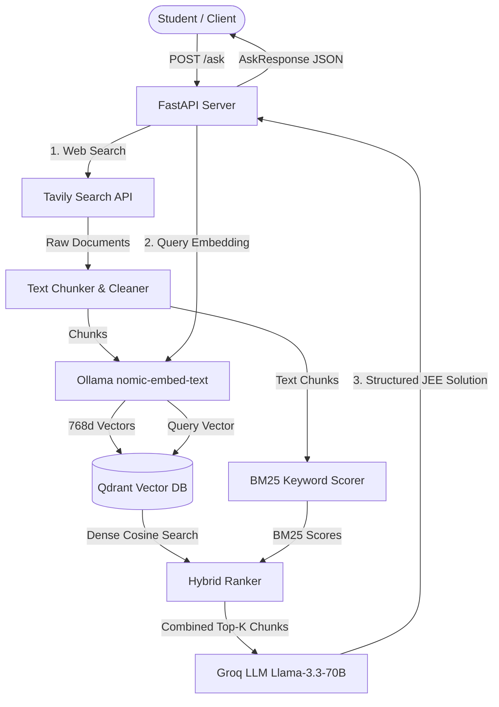

# JEE-RAG: Advanced IIT-JEE Retrieval-Augmented Generation

An intelligent, high-accuracy Question-Answering system designed specifically for **IIT-JEE Advanced & Main** (Physics, Chemistry, and Mathematics).

The pipeline combines web retrieval via **Tavily**, local dense vector embeddings via **Ollama**, hybrid dense + BM25 ranking indexed with **Qdrant Vector Database**, and rigorous step-by-step reasoning via **Groq** (`llama-3.3-70b-versatile`) enforced by an elite JEE tutor prompt template.

---

## Architecture & Workflow



---

## Tech Stack & Components

| Component | Technology | Purpose |
| :--- | :--- | :--- |
| **Framework** | FastAPI + Uvicorn | Async REST API & OpenAPI documentation |
| **Search Engine** | Tavily API | Clean, ad-filtered educational search results |
| **Embeddings** | Ollama (`nomic-embed-text`) | 768-dimensional local vector embeddings |
| **Vector Database** | Qdrant Cloud / Local | High-performance vector indexing & similarity search |
| **Lexical Search** | BM25 (Custom implementation) | Term-frequency and inverted index scoring |
| **LLM Inference** | Groq (`llama-3.3-70b-versatile`) | Fast, low-latency reasoning with strict JEE guidelines |

---

## Prerequisites

1. **Python**: Python 3.10, 3.11, 3.12, or 3.13.
2. **Ollama**: Installed and running locally ([Download Ollama](https://ollama.ai)).
   ```bash
   ollama pull nomic-embed-text
   ```
3. **Groq API Key**: Create an account and key at [Groq Console](https://console.groq.com).
4. **Tavily API Key**: Get a search key from [Tavily](https://app.tavily.com).
5. **Qdrant**: A managed cluster at [Qdrant Cloud](https://cloud.qdrant.io) or a local Docker instance.

---

## Quickstart

### 1. Set Up Virtual Environment

```bash
# Clone the repository and navigate into it
cd d:\PROJECTS\JEE-RAG

# Create virtual environment (if not already created)
python -m venv .venv

# Activate virtual environment
# Windows (PowerShell):
.\.venv\Scripts\Activate.ps1
# Windows (CMD):
.\.venv\Scripts\activate.bat
# Linux / macOS:
source .venv/bin/activate
```

### 2. Install Dependencies

```bash
pip install -r requirements.txt
```

### 3. Configure Environment Variables

Create a `.env` file in the project root:

```bash
copy .env.example .env
```

Edit `.env` with your actual credentials:

```dotenv
GROQ_API_KEY=gsk_your_groq_api_key_here
TAVILY_API_KEY=tvly-your_tavily_api_key_here
QDRANT_URL=https://your-cluster-id.eu-central-1-0.aws.cloud.qdrant.io
QDRANT_API_KEY=your_qdrant_api_key_here
QDRANT_COLLECTION=jee-rag
OLLAMA_BASE_URL=http://localhost:11434
OLLAMA_EMBED_MODEL=nomic-embed-text
GROQ_MODEL=llama-3.3-70b-versatile
HOST=0.0.0.0
PORT=8000
```

### 4. Verify Setup

Run the built-in diagnostic tool to test dependencies, API keys, and external services:

```bash
python verify_setup.py
```

### 5. Launch the Server

Run using any of the following methods:

**Option A: Direct Python**
```bash
python main.py
```

**Option B: One-click script (Windows)**
```powershell
.\run.ps1
# or
run.bat
```

**Option C: Uvicorn directly**
```bash
uvicorn main:app --host 0.0.0.0 --port 8000 --reload
```

---

## API Reference

Once running, interactive Swagger UI is available at: `http://localhost:8000/docs`

### Health Check

- **URL**: `GET /health`
- **Response**:
  ```json
  {
    "status": "ok"
  }
  ```

### Ask JEE Question

- **URL**: `POST /ask`
- **Headers**: `Content-Type: application/json`
- **Request Body**:
  ```json
  {
    "question": "A particle moves in a circle of radius R. What is the centripetal acceleration if speed is v?"
  }
  ```

- **Example Response**:
  ```json
  {
    "question": "A particle moves in a circle of radius R. What is the centripetal acceleration if speed is v?",
    "answer": "IDENTIFY: Uniform Circular Motion - Centripetal Acceleration\n\nKEY PRINCIPLES:\n- Centripetal acceleration is directed toward the center of curvature.\n- Formula: a_c = v^2 / R or a_c = \u03c9^2 * R\n- Speed v is constant along the circular path.\n\nSOLUTION:\n1. Formulation:\n   - Let the velocity vector be v tangent to circle of radius R.\n   - Rate of change of direction gives centripetal acceleration magnitude a_c = v^2 / R.\n\nANSWER:\na_c = \\frac{v^2}{R}",
    "sources": [
      {
        "url": "https://example.com/circular-motion",
        "title": "Circular Motion Fundamentals",
        "snippet": "Centripetal acceleration magnitude is given by v^2 / R."
      }
    ],
    "context_chunks": [
      {
        "url": "https://example.com/circular-motion",
        "title": "Circular Motion Fundamentals",
        "chunk_text": "For a particle moving at speed v along circle radius R, a = v^2 / R.",
        "score": 0.88
      }
    ]
  }
  ```

---

## Project Structure

```text
JEE-RAG/
├── .env.example          # Environment variable template
├── .gitignore            # Git exclusion rules
├── config.py             # Settings loading and validation via pydantic/dataclasses
├── embedder.py           # Ollama async batch embedding client
├── generator.py          # Groq LLM client with IIT-JEE tutor system prompt
├── main.py               # FastAPI application, CORS, and endpoint definitions
├── models.py             # Pydantic schemas (AskRequest, AskResponse, ContextChunk)
├── requirements.txt      # Python dependencies
├── retriever.py          # Chunking, Qdrant upsert/query, and BM25 hybrid ranking
├── search.py             # Tavily web search and domain filtering
├── verify_setup.py       # Diagnostic script for checking setup & credentials
├── run.ps1               # PowerShell startup script
└── run.bat               # Windows Batch startup script
```
